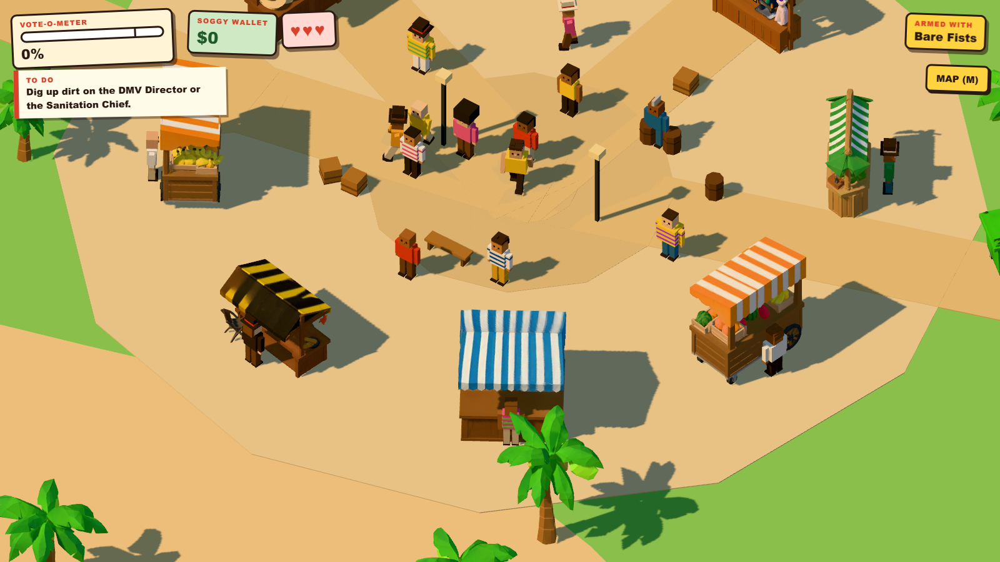
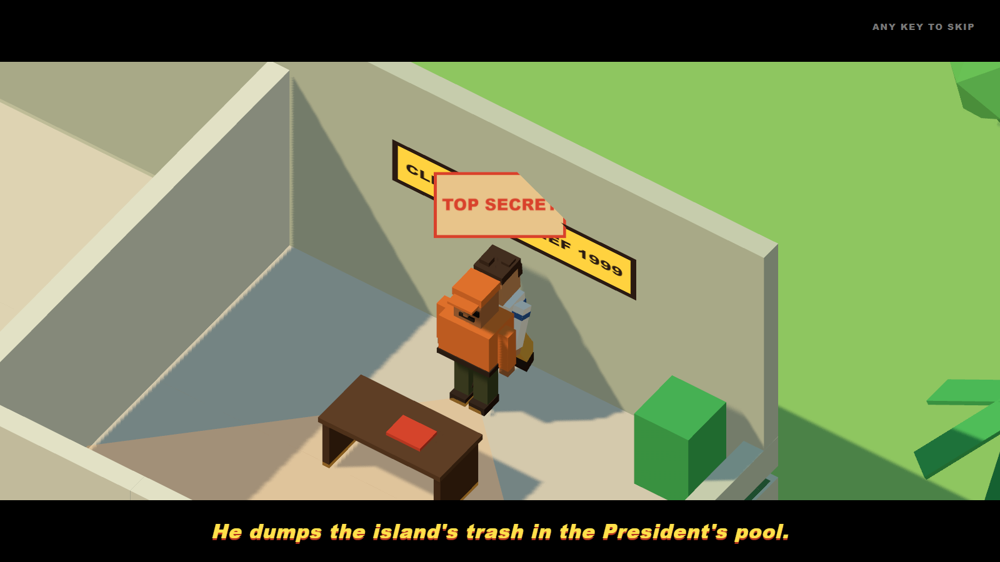

<p align="center">
  
</p>

<h1 align="center"> COUP D'ETAT, BABY! </h1>

<p align="center">
  <b>Shipwrecked. Broke. Running for president.</b><br/>
  A low-poly stealth-brawler about blackmail, baguettes and one very dirty election.
</p>

<p align="center">
  
  
  
  
</p>

---

##  The pitch

You wash up on **Isla Corrupta** with one flip-flop. Five officials run the island. Find their secrets, blackmail them, and win the presidency with **102% of the vote**.

<p align="center">
  
</p>

##  Your route

|  Start |  Escalate |  Win |
| :---: | :---: | :---: |
| Loot the wreckage, reach the market | Hijack the DMV, Sanitation, Tax Office and State TV | Take the Palace |

##  How it plays

|What you do |
| --- |
| Search wreckage, safes and desks for cash |
| Sneak past guards, hide, climb or take them down |
| Buy ever-sillier weapons at the market |
| Reach the top floor and steal the secret dossier |
| Blackmail the official and collect their endorsement |

<table>
  <tr>
    <td align="center"><br/><b>🏖️ The beach</b></td>
    <td align="center"><br/><b>🛍️ The market</b></td>
  </tr>
  <tr>
    <td align="center"><br/><b>🗑️ Sanitation Dept.</b></td>
    <td align="center"><br/><b>🗺️ Island map (press M)</b></td>
  </tr>
</table>

## Controls

| Key | Action | Key | Action |
| :---: | --- | :---: | --- |
| `WASD` | Move | `E` | Interact, loot, blackmail |
| `Shift` | Sprint | `Click` / `F` | Attack or takedown |
| `C` | Crouch | `M` | Island map |
| `Space` | Climb | `N` | Mute |

## Gallery

<table>
  <tr>
    <td align="center"><br/><b>📂 Secret found</b></td>
    <td align="center"><br/><b>🤝 Blackmail</b></td>
    <td align="center"><br/><b>🏆 Election finale</b></td>
  </tr>
</table>

##  Play locally

```bash
npm install
npm run dev
```

Then open `http://localhost:5173`.

---

<p align="center"><sub>Made for a 12-hour game jam. No officials were harmed. Several were blackmailed.</sub></p>

## Build

| Command | Output |
| --- | --- |
| `npm run pack:itch` | `release/CoupDetatBaby-<version>-itch-html5.zip` (upload as an HTML game) |
| `npm run pack:win` | Windows zip + portable `.exe` |
| `npm run pack:linux` | Linux zip |
| `npm run pack:mac` | macOS zip (run on a Mac) |

Push a `v*` tag to build Windows, Linux and macOS packages in CI (`.github/workflows/desktop.yml`).

## Versioning and releases

The version lives in `package.json` and is the single source of truth. It is
injected into the game at build time (`vite.config.js`) and shown on the title
screen, and it is used in the itch.io and desktop artifact filenames.

Releases follow [Semantic Versioning](https://semver.org/) and are tracked in
[`CHANGELOG.md`](CHANGELOG.md):

| Change | Command |
| --- | --- |
| Bug fix / polish | `npm version patch` |
| New content or feature | `npm version minor` |
| Breaking change | `npm version major` |

`npm version <level>` bumps `package.json` + `package-lock.json`, commits them,
and creates the matching `v<version>` git tag. Push both the commit and the tag:

```bash
git push
git push --tags
```

The tag triggers the desktop workflow and attaches the built packages to a
GitHub release. For itch.io, run `npm run pack:itch` after the bump and upload
the resulting zip with **This file will be played in the browser** ticked.

Note: `npm version` creates a commit, so commit your gameplay changes first.

