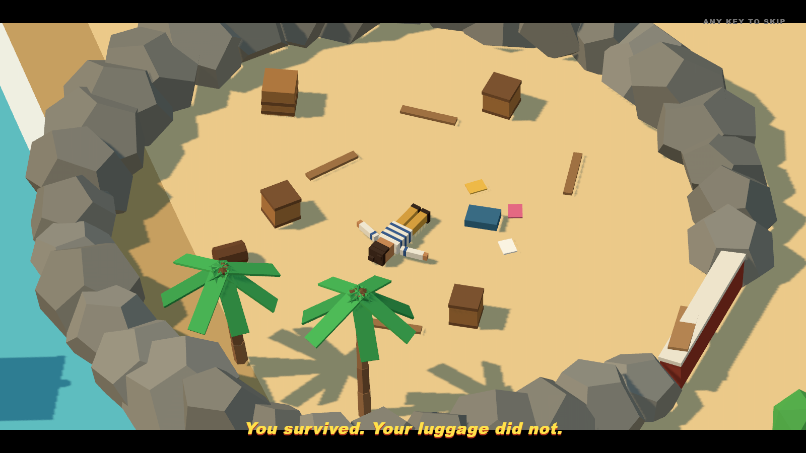
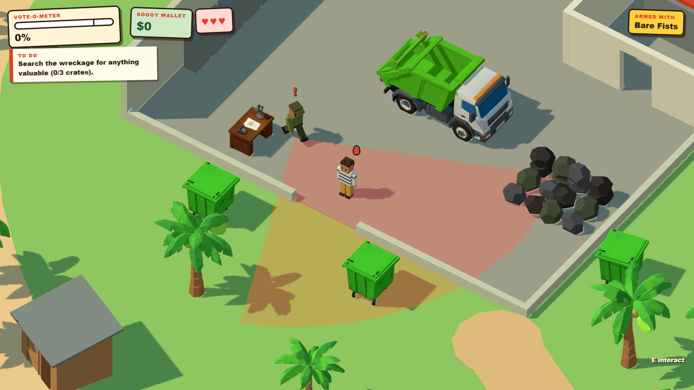
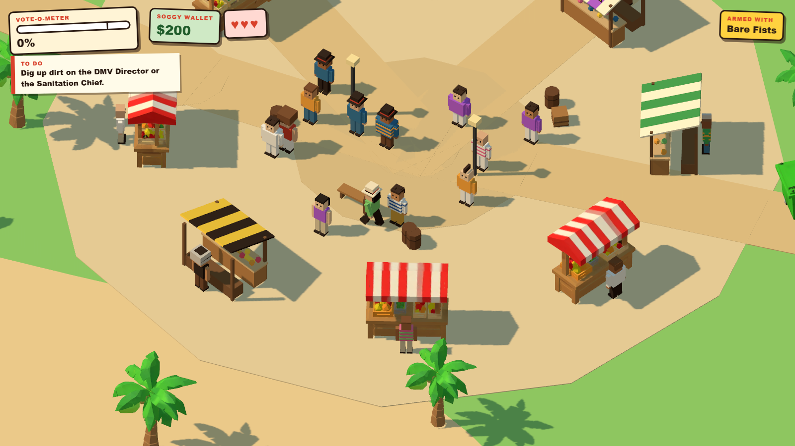

<p align="center">
  
</p>

<h1 align="center">COUP D'ETAT, BABY!</h1>

<p align="center">
  <strong>A low-poly stealth-brawler about turning political secrets into power.</strong>
</p>

<p align="center">
  STEALTH-BRAWLER &nbsp; | &nbsp; 10-15 MINUTES &nbsp; | &nbsp; ONE VERY DIRTY ELECTION
</p>

---

## The pitch

You wash up on **Isla Corrupta** with nothing but a flip-flop and an appetite for leverage. Raid guarded offices, uncover five officials' secrets, and blackmail your way to the presidency.

Every takeover raises your clout. Campaign banners appear over captured buildings, new territory opens, and the route to the Palace gets shorter.

<p align="center">
  
</p>

## Judge's route

| Start | Escalate | Win |
| --- | --- | --- |
| Follow the wreckage tutorial. | Hijack the DMV, Sanitation, Tax Office, and State TV. | Take the Palace and win with 102% of the vote. |

The first targets unlock after reaching the market. A full run tells a complete story: shipwreck, campaign of blackmail, absurd election, and final sting.

---

## How it plays

### Break in. Find dirt. Take over.

1. Search wreckage, safes, and desks for cash.
2. Sneak past guards, hide, climb, or take them down.
3. Buy increasingly ridiculous weapons.
4. Reach upper floors and recover a secret dossier.
5. Confront the official, blackmail them, and claim their endorsement.

Standing makes you easier to spot. Sprinting makes noise. Crouching reduces guard vision, while hiding spots let danger pass. Each office rewards a different piece of political leverage.

<p align="center">
  
</p>

## Highlights

| Stealth and combat | Political progression |
| --- | --- |
| Patrols, detection meters, hiding spots, climbing, melee, and takedowns. | Five officials, secret dossiers, campaign banners, clout, and a Palace finale. |
| Loot and gear | Island atmosphere |
| Safes, desks, crates, rubber chickens, stale baguettes, folding chairs, and golden briefcases. | Beaches, offices, market stalls, storms, crowds, music, and reactive sound. |

---

## Controls

| Input | Action |
| --- | --- |
| `WASD` | Move |
| `Shift` | Sprint |
| `C` | Crouch |
| `Space` | Climb low obstacles |
| `Click` or `F` | Attack or takedown |
| `E` | Interact, loot, or blackmail |
| `M` or MAP button | Island map |
| `N` | Mute |

## Gallery

| Market | Secret found |
| --- | --- |
|  |  |

| Campaign takeover | Election finale |
| --- | --- |
|  |  |

---

## Play locally

```bash
npm install
npm run dev
```

Open `http://localhost:5173`.

<p align="center"><sub>Created for a 12-hour game jam.</sub></p>
