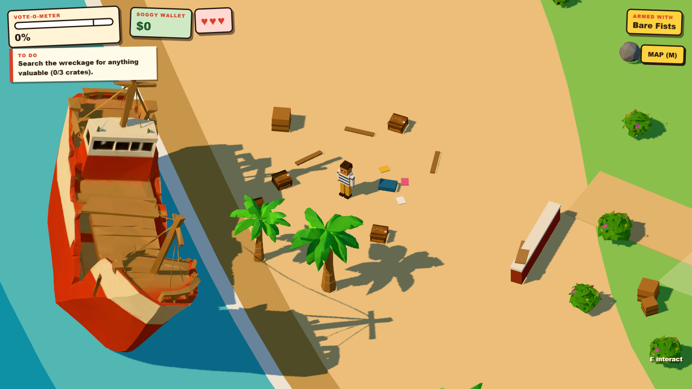
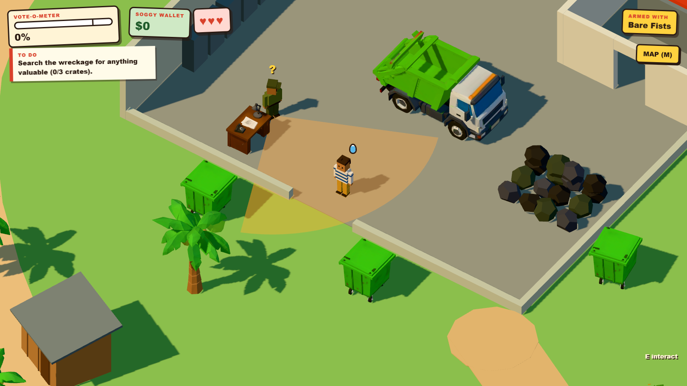
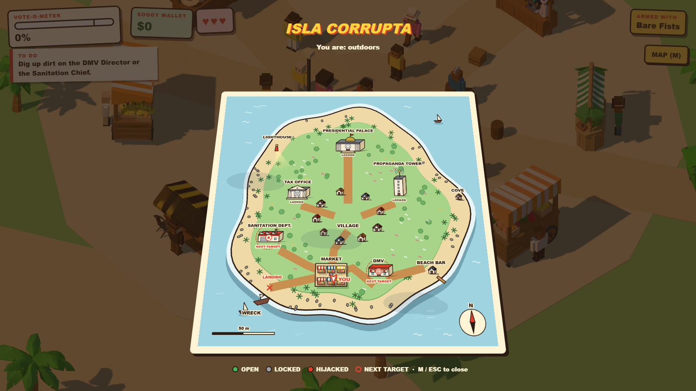
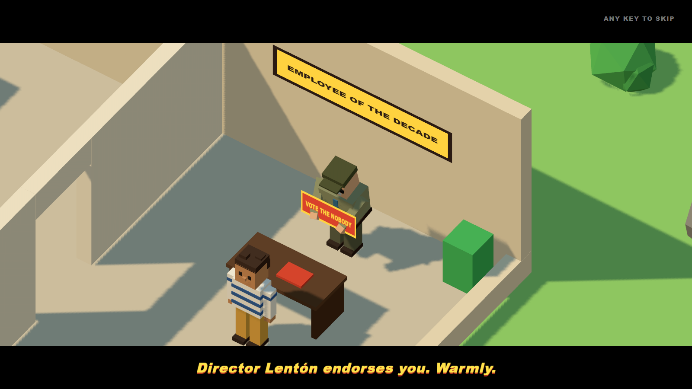

<p align="center">
  
</p>

<h1 align="center">🌴 COUP D'ETAT, BABY! 🌴</h1>

<p align="center">
  <b>Shipwrecked. Broke. Running for president.</b><br/>
  A low-poly stealth-brawler about blackmail, baguettes and one very dirty election.
</p>

<p align="center">
  
  
  
  
</p>

---

## 🏝️ The pitch

You wash up on **Isla Corrupta** with one flip-flop. Five officials run the island. Find their secrets, blackmail them, and win the presidency with **102% of the vote**.

<p align="center">
  
</p>

## 🎯 Your route

| 🏖️ Start | 🕵️ Escalate | 👑 Win |
| :---: | :---: | :---: |
| Loot the wreckage, reach the market | Hijack the DMV, Sanitation, Tax Office and State TV | Take the Palace |

## 🎮 How it plays

| Step | What you do |
| :---: | --- |
| 🔍 | Search wreckage, safes and desks for cash |
| 🥷 | Sneak past guards, hide, climb or take them down |
| 🛒 | Buy ever-sillier weapons at the market |
| 📂 | Reach the top floor and steal the secret dossier |
| 🤝 | Blackmail the official and collect their endorsement |

<table>
  <tr>
    <td align="center"><br/><b>🏖️ The beach</b></td>
    <td align="center"><br/><b>🛍️ The market</b></td>
  </tr>
  <tr>
    <td align="center"><br/><b>🗑️ Sanitation Dept.</b></td>
    <td align="center"><br/><b>🗺️ Island map (press M)</b></td>
  </tr>
</table>

## ✨ Highlights

| 🥷 Stealth | 🥊 Combat | 🗳️ Politics | 🎵 Atmosphere |
| :---: | :---: | :---: | :---: |
| Patrols, detection meters, hiding spots | Melee, takedowns, rubber chickens | Dossiers, banners, clout | Storms, crowds, music |

## 🕹️ Controls

| Key | Action | Key | Action |
| :---: | --- | :---: | --- |
| `WASD` | Move | `E` | Interact, loot, blackmail |
| `Shift` | Sprint | `Click` / `F` | Attack or takedown |
| `C` | Crouch | `M` | Island map |
| `Space` | Climb | `N` | Mute |

## 📸 Gallery

<table>
  <tr>
    <td align="center"><br/><b>📂 Secret found</b></td>
    <td align="center"><br/><b>🤝 Blackmail</b></td>
    <td align="center"><br/><b>🏆 Election finale</b></td>
  </tr>
</table>

## 🚀 Play locally

```bash
npm install
npm run dev
```

Then open `http://localhost:5173`.

---

<p align="center"><sub>Made for a 12-hour game jam. No officials were harmed. Several were blackmailed.</sub></p>
