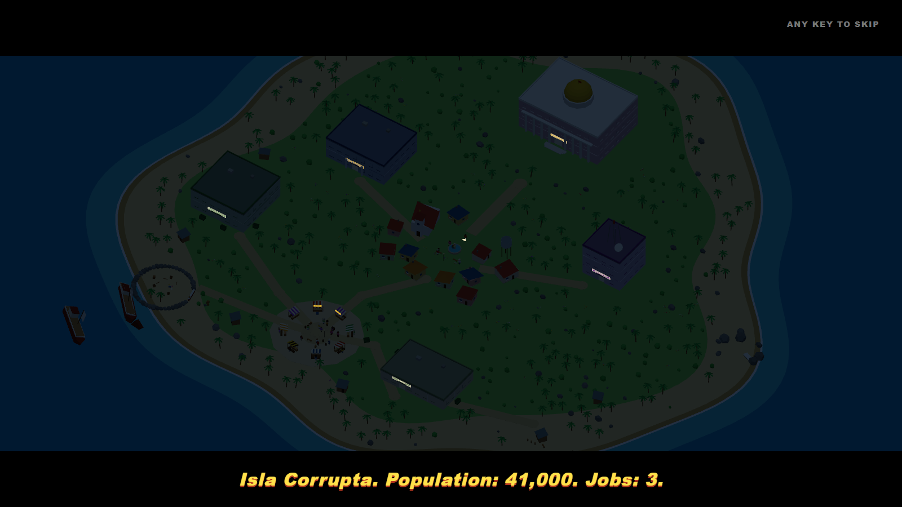
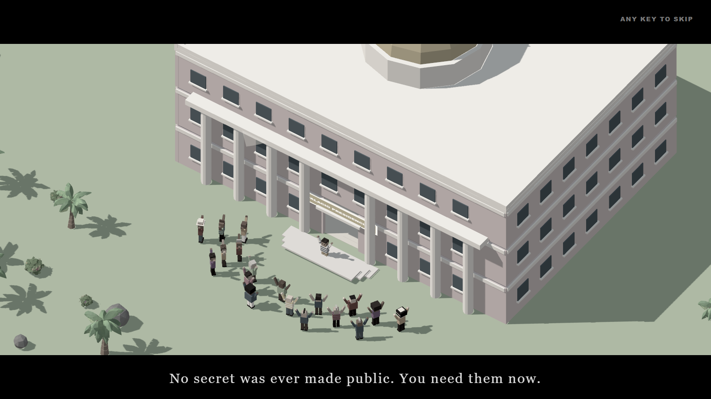

<p align="center">
  
</p>

<h1 align="center">COUP D'ETAT, BABY!</h1>

<p align="center">
  <strong>A low-poly stealth-brawler where democracy is a dirty word and a rubber chicken is a legitimate weapon.</strong>
</p>

<p align="center">
  STEALTH-BRAWLER &nbsp; | &nbsp; 10-15 MINUTES &nbsp; | &nbsp; ONE VERY DIRTY ELECTION
</p>

---

## The pitch

Your ship has sunk. Your luggage is gone. Your dignity is somewhere off the coast, and you have washed up on **Isla Corrupta** with one flip-flop and a burning need for leverage.

Every takeover of government officials raises your clout.

<p align="center">
  
</p>

## Judge's route

| Start | Escalate | Win |
| --- | --- | --- |
| Rummage through the wreckage. Crates are free. Ethics are on back order. | Hijack the DMV, Sanitation, Tax Office, and State TV. | Take the Palace and win with 102% of the vote. The extra 2% voted twice. |

The first targets unlock once you reach the market. A full run tells a complete story: shipwreck, blackmail, an election that would make a statistician cry, and a final sting.

---

## Day one: the beach

You start on a clean stretch of sand with three crates of soggy cash and no plan. Search the wreckage, pocket whatever floats, and walk to the market. The beach used to have a decorative ring of rocks. We removed it, so you can't blame the scenery for your choices.

<p align="center">
  
</p>

---

## How it plays

### Break in. Find dirt. Take over.

1. Search wreckage, safes, and desks for cash.
2. Sneak past guards, hide, climb, or take them down with whatever is in your hand.
3. Buy increasingly ridiculous weapons.
4. Reach the upper floors and recover a secret dossier.
5. Confront the official, blackmail them, and claim their endorsement. Handshake optional.

Standing makes you easier to spot. Sprinting makes noise. Crouching shrinks guard vision, and hiding spots let danger walk right past you, which is also how most politicians handle danger.

<p align="center">
  
</p>

## Highlights

| Stealth and combat | Political progression |
| --- | --- |
| Patrols, detection meters, hiding spots, climbing, melee, and takedowns. Guards say "huh?" a lot. | Five officials, secret dossiers, campaign banners, clout, and a Palace finale. |
| Loot and gear | Island atmosphere |
| Safes, desks, crates, rubber chickens, stale baguettes, folding chairs, and golden briefcases. | Beaches, offices, market stalls, storms, crowds, music, and reactive sound. |

### The market never sleeps

The market is Isla Corrupta's social hub. Locals circle eight stalls while vendors sell weapons, hairstyles, outfits, and coconut water. It is a breather between break-ins, and the place where stolen cash becomes questionable equipment.

<p align="center">
  
</p>

### The map: because getting lost is not a campaign strategy

Press `M` for a hand-drawn, slightly tilted map of the island. Sailboats bob in the sea, the lighthouse sweeps its beam across the coast, and cloud shadows drift over the palms. Every civic building has its own look: the Palace has a gold dome, the Tax Office has columns it definitely did not pay for, and the Propaganda Tower has an antenna that never stops talking.

Status is shown by colour: green is open, grey is locked, red is hijacked, and a spreading red ring means "go here next". The map pauses the game, so you can study it in peace while the guards wait patiently, which is the least realistic thing in the game.

<p align="center">
  
</p>

---

## Controls

| Input | Action |
| --- | --- |
| `WASD` | Move |
| `Shift` | Sprint |
| `C` | Crouch |
| `Space` | Climb low obstacles |
| `Click` or `F` | Attack or takedown |
| `E` | Interact, loot, or blackmail |
| `M` or MAP button | Island map |
| `N` | Mute |

## Gallery

| Secret found | Campaign takeover |
| --- | --- |
|  |  |

| Election finale |
| --- |
|  |

---

## Play locally

```bash
npm install
npm run dev
```

Open `http://localhost:5173`, then go commit some light democracy.

<p align="center"><sub>Created for a 12-hour game jam. No officials were harmed. Several were blackmailed.</sub></p>
